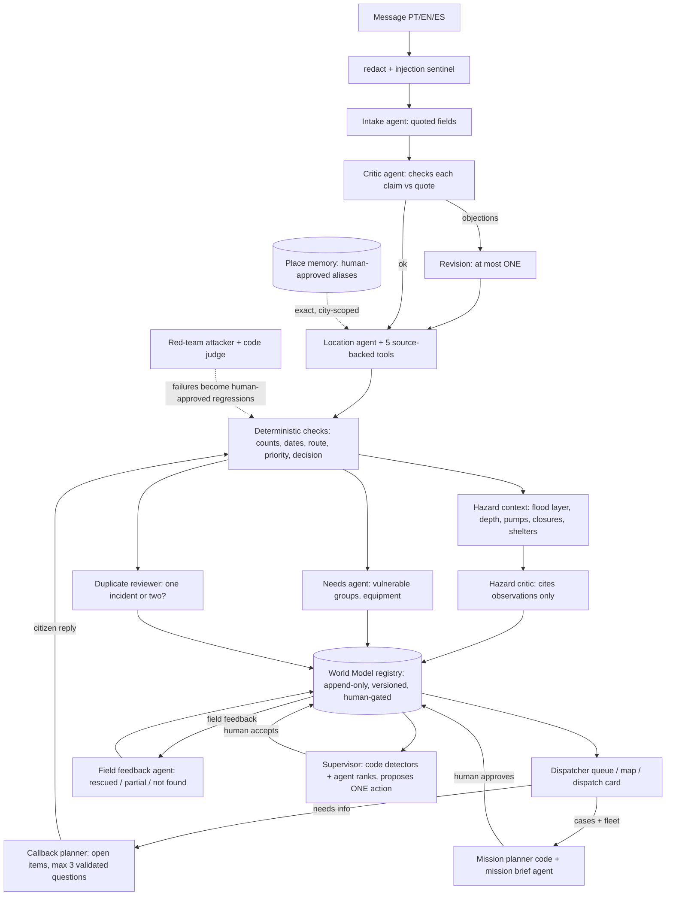

# Rescue Triage Desk

A dispatcher desk for the next Rio Grande do Sul flood, built and tested on the **May 2024 RS floods**
(Porto Alegre and region). Citizens write messy Portuguese rescue requests; dispatchers need to know *where*,
*how many*, *who is vulnerable*, *what is already rescued* and *which asset can safely go*, quickly and with
evidence they can check. The desk turns each message into an evidence-linked case, checks places, counts and
hazards **with code**, asks the citizen what is missing, groups cases into missions, and **a human approves every
dispatch**. It is a retrospective replay desk, not a deployed emergency system: nothing is dispatched automatically.

**Design rule.** Nemotron (via Meterless Nightshift) reads language, spots contradictions, asks questions and explains
revisions, always with exact quotes or fact ids that a validator checks. Code does every join, distance, count, rank,
freshness gate and state change. An agent exists only where it decides something code cannot.

## Architecture



The Location agent's five tools are street/designator search, landmark aliases and categories, bairro catalogue, bounded nearby/corner geometry and exact-quote checking.

| Component | Kind | Where | What the agent decides / what code checks |
|---|---|---|---|
| Intake, Critic, one Revision | agents | `app/agents/intake.py`, `critic.py` | Extract fields with exact quotes; critic objects to unsupported claims; code verifies every quote span |
| Location agent + tools | agent with tool loop (max 3 requests) | `app/agents/location.py`, `location_tools.py` | Picks among catalogue candidates; code validates ids, city, caller-vs-incident clause, precision |
| Hazard critic | agent | `app/agents/hazard_critic.py` | Writes cautions only from cited observations; code computes the observations |
| Needs | agent | `app/agents/needs.py` | Tags vulnerable groups/equipment from quotes; code derives counts; visible `deterministic_only` fallback |
| Duplicate reviewer | agent | `app/agents/duplicate_reviewer.py`, `app/duplicates.py` | Code proposes candidates; agent judges; human merges/unmerges (reversible) |
| Callback planner | agent | `app/callback/` | ≤3 questions mapped to open items; invalid plan → visible code templates |
| Field feedback | agent | `app/feedback.py` | Reads crew reports (rescued / partial / not found) with exact quote; code updates counts |
| Mission planner + brief | code + agent | `app/missions/` | Code groups, splits by capacity, vetoes unsafe assets; agent writes the brief; human approves |
| Supervisor | code detectors + agent | `app/supervisor/` | Detectors cite fact ids; agent ranks/proposes one allowed action; next tick verifies |
| Red team | attacker agent + code judge | `app/redteam/` | Attacker declares expected outcome before the pipeline runs (hashed); failures need human approval to become regressions |
| Place memory | code, human-gated | `app/memory/` | Learned aliases are exact, city-scoped, revocable and never auto-promoted from model output |
| Credibility reviewer | agent (module + eval exist; **not yet wired into `/run`**) | `app/credibility/` | Judges only code-found signals; never discards a message |
| **World Model** | Meterless Engine (our Python adaptation) | `app/engines/world_model/registry.py` | Event replay, dedup, stale/conflict retention, expected-version gates, human-only transitions |

Every agent call is streamed with thinking on, parsed as strict JSON, retried at most once, and falls back visibly
(never a silent success). Injection-like text is routed to `REVIEW_REQUIRED`; an unsafe asset is blocked with a reason.

## Setup

Python 3.12 is the Docker target; only the standard library and vendored files (MapLibre, fonts) are used. No `pip install`.

```powershell
Copy-Item .env.example .env            # placeholders only; never commit .env
python -m unittest discover -s tests   # offline, no services
python run.py --sample --input examples/input_01.json
python run.py serve --sample           # http://localhost:8080  (binds 0.0.0.0)
```

Open <http://localhost:8080> (classic page) or `/v2` (dispatcher console). Use fictional messages only; the server binds all interfaces, so use a trusted network.

**SAMPLE_MODE** (`SAMPLE_MODE=true` or `--sample`) uses local CSVs/GeoJSON, needs no Zetaris, Nightshift or network,
recomputes everything from the submitted text and never reads saved answers or truth labels. Agent panels then say
"unavailable offline": this shows the regex baseline plus all deterministic checks, not Nemotron. The CLI/server writes registry state to `runtime/`.

**Connected mode** (`SAMPLE_MODE=false`): fill `.env` locally (`.env.example` has one comment per setting).

| Service | Default endpoint |
|---|---|
| Meterless Nightshift (OpenAI-compatible; primary and only AI provider) | `http://127.0.0.1:8088/v1` |
| Zetaris REST (data layer) | `http://localhost:8888/api/v1.0` |
| SeaweedFS S3 on host / as seen from Zetaris containers | `127.0.0.1:8333` / `http://oah-s3:8333`, bucket `oah-s3` |

Zetaris: `python tools/load_zetaris.py --version v4` registers the CSV tables (`streets_flood_v4`, `landmarks_v4`,
`closures_v4`, `pump_status_daily_v4`, `pumps_v4`, `events_v4`, `shelters_v4`, `street_points_v4`, `messages_seed7_v4`)
over staged S3 files; `python tools/smoke_live.py` checks each service and runs cases end to end. The last live check reported
here (24 Oct 2026) used the v3 tables (`streets_flood_v3` 12,586 rows, `landmarks_v3` 4,201, `messages_seed7_v3` 15, `road_closures_v3` 31,
`landmark_aliases_v3` 24, `inferSchema=false`); the **v4 load and smoke run are [TBD-live-number]**.
Flood polygons, depth grids and levees stay local files in both modes; curated aliases always come from `data/landmark_aliases.csv`.
Keep `NIGHTSHIFT_MAX_CONCURRENCY` low (default 2) and never lower `NIGHTSHIFT_MAX_TOKENS` (thinking consumes it).

### Docker

```powershell
docker build -t rescue-triage-desk .
docker run --rm -p 8080:8080 rescue-triage-desk                    # SAMPLE_MODE=true is the image default
docker run --rm -p 8080:8080 --env-file .env -e SAMPLE_MODE=false `
  -e NIGHTSHIFT_BASE_URL=http://host.docker.internal:8088/v1 `
  -e ZETARIS_REST_URL=http://host.docker.internal:8888/api/v1.0 -e S3_ENDPOINT_HOST=host.docker.internal:8333 rescue-triage-desk
```

`.dockerignore` keeps `.env`, `runtime/`, `logs/`, `.git`, review/report files and caches out of the image.
`docker build` has not been executed yet. The build context was listed and a clean copy of it (no `.env`) served one offline
`POST /run` (evidence in `docs/submission/GATE2_CHECKLIST.md`). Container-to-host routing for connected mode: [TBD-live-number: not verified end to end].

## Evaluations

Offline commands need nothing running. Live commands call Nightshift (and Zetaris) and are run by the operator only.

```powershell
python eval/run_adversarial.py --offline        # 24 hostile/odd messages; --live (or no flag) uses Nightshift
python eval/run_dialogues.py --offline          # multi-turn citizen replies
python eval/run_location.py                     # 30 location cases, scripted policy (--live for Nightshift)
python eval/run_missions.py --offline           # mission grouping + needs tags    (--live)
python eval/run_supervisor.py --offline         # supervisor detectors and loops   (--live)
python eval/run_callback.py                     # callback planner                 (--live)
python eval/run_feedback.py --offline           # field feedback                   (--live)
python eval/run_duplicates.py --offline         # duplicate candidates
python eval/run_hazard_eval.py --offline        # hazard critic wiring only
python eval/run_credibility.py                  # credibility signals              (--live)
python eval/run_redteam.py --n 24 --seed 1      # self-play red team               (--live)
python eval/run_eval.py --offline               # generated + challenge sets; rewrites eval/results.json, never results_live.json
```

**Offline results** (synthetic sets; scripted stand-ins where noted; **they do not measure Nemotron**). Rows were re-run on 25 Oct 2026
for this README (saved in the build workspace as `out/g3_evals/*`) and cross-checked with the named build report (`out/<ID>_REPORT.md`
in the build workspace, not shipped in this repo). The last recorded full suite was 396 tests (commit `28aa6d8` message); [TBD: final suite count at release].

| Eval | Result | Build report |
|---|---|---|
| Adversarial (24) | decisions 24/24, key fields 100%, routes 23/24 (`adv-pets`: frozen label says incomplete, desk routes `not_a_rescue`), 0 unsafe sends, 0 crashes | `F1_REPORT`, `SAFE1_REPORT` |
| Red team `--n 42` | 35/42 → 42/42, unsafe SENDs 6 → 0; each of 14 categories 3/3 | `SAFE1_REPORT` |
| Out-of-area (491 RS municipalities vs covered cities) | 491/491 | `SAFE1_REPORT` |
| Missions (12 scenarios) | grouping 12/12, capacity violations 0, blocked-asset assignments 0, life-safety-first 100%; needs 15/15 (deterministic fallback) | `M1_REPORT` |
| Supervisor (10 scenarios) | TP 8, FP 0, FN 0, loops 4/4, uncited numbers 0 | `S1_REPORT` |
| Callback (12 cases; scripted planner, labelled simulator) | 11/16 items resolved (68.8%), 0.92 questions/case, 0 invented facts | `C1_REPORT` |
| Field feedback (15 dialogues) | 15/15 | `F1_REPORT` |
| Location (30; scripted policy, critic stubbed) | resolved 20/30, identity 26/30, precision 25/30, wrong city 0 | `L1_REPORT`, `L3_REPORT`, `L4_REPORT` |
| Dialogues (10) | final decision 7/10 in the latest tree (earlier reports: 10/10); unreconciled, see limitations | `A35_REPORT`, `H3_REPORT` |

### Live evaluation

Last measured **24 Oct 2026** on the *first* pipeline (Intake → Critic → Revision → Location; `eval/results_live.json`):

| Set | Method | Decision accuracy | Mean s / msg | p90 s | Calls / msg |
|---|---|---:|---:|---:|---:|
| Generated (30, seeds 101/202) | rules baseline | 1.00 | 0.8 | 1.1 | 0 |
| | intake agent | 0.97 | 11.7 | 23.2 | 1.0 |
| | full loop | 1.00 | 19.6 | 31.0 | 2.4 |
| Challenge (40, hand-written) | rules baseline | 0.60 | 0.5 | 1.0 | 0 |
| | intake agent | 0.975 | 15.5 | 27.8 | 1.0 |
| | full loop | 0.975 | 53.5 | 98.9 | 3.2 |

Field F1 on the challenge set, rules → full loop: children 0.25 → 0.96, elderly 0 → 0.89, disabled 0 → 0.86, pets 0.29 → 0.91,
street 0.32 → 0.95, house number 0.36 → 1.00, municipality 0.58 → 0.97. Critic: 18 of 40 messages got objections → 18 revisions →
22 field changes: 18 correct, 3 wrong, 1 neutral. Generated messages come from templates (rules score perfectly there); the challenge
set is small and its text rules were adjusted after seeing it, so those numbers are optimistic. The full loop costs about 3.5× the latency of intake alone.

**Live numbers for the current system (location tools, duplicates, callback, missions, supervisor, hazard critic, red team): [TBD-live-number].**
A blind held-out batch and a 15-message end-to-end wall-time run are still to be measured; do not quote the table above for them.

## Engine test (Meterless World Model)

`app/engines/world_model/registry.py` is our behavioural adaptation of the World Model (not an imported SDK): append-only journal,
event replay, deduplication, retained stale/conflicting observations, expected-version gates (409 on stale commands) and human-only
transitions. It backs the queue, merges, callbacks, missions, feedback and supervisor ticks.

```powershell
python -m unittest discover -s tests -p test_core.py -v        # RegistryTests: human gate + versions, stale retained/rebuild, 10 concurrent writers
python -m unittest discover -s tests -p test_pipeline.py -v    # PipelineTests.test_http_run_queue_action_and_stale_version
```

These are offline tests, not sponsor certification. Place memory deliberately does **not** claim to be H-MEM (spec mismatch: the H-MEM spec ranks model-generated memories; ours must be exact, city-scoped and human-approved).

## API, traces, examples

`POST /run` takes `replay_time` and 1–15 `messages` (`message_id`, `text`, optional `received_at`); see `examples/input_01.json`.
Other routes: `GET /api/cases`, `POST /api/cases/{id}/actions` (action, actor, `expected_version`; stale → 409), `/api/cases/{id}/callback`,
`/api/cases/{id}/card`, `/api/missions*`, `/api/supervisor*`, `/api/replay/*`, `/api/memory`, `/api/redteam`,
`GET /api/map?date=` ([map contract](docs/MAP_API.md), [UI notes](docs/UI_V2.md)).
Three request files and three pipeline-produced outputs are in `examples/` ([provenance](examples/README.md)); they are saved artifacts, not live measurements.

Nightshift calls write JSONL to `logs/run_<id>.jsonl` and stdout (role, message id, requested model, routed model, receipt, status, duration).
Missing provider metadata stays null. The response budget is 480 s with partial results; calls time out at 75 s with at most three attempts;
one run per desk.

## Data provenance

"Kind": **pre-event** = existed before May 2024; **live-equivalent** = a real-time source whose per-record publication time is kept
(usable for replay date D only if published ≤ D); **retrospective stand-in** = produced or published after the event, labelled
`retrospective` with low confidence and kept out of contemporaneous priority. No-hindsight rule: a layer counts for date D when its
observation date ≤ D. Unknown ≠ dry or safe.

| Layer | Source | Licence | Observed vs published | Kind |
|---|---|---|---|---|
| Streets (12,586 rows) | OpenStreetMap, D1 snapshot 2024-06-15 | ODbL 1.0 | Snapshot after the event; features pre-date it | pre-event content, post-event snapshot |
| Named landmarks (4,201) | OSM Overpass, 2026-10-24 | ODbL 1.0 | Snapshot 2.5 years after; features pre-date it | pre-event content, post-event snapshot |
| Observed flood extent, 6 and 8 May | Possantti et al. (UFRGS), Zenodo 14617475 / 11164049 | CC BY 4.0 per source brief (record page shows no licence id) | Observed 2024-05-06/08; per-layer publication unknown (earliest record version 2024-05-09) | retrospective stand-in |
| Flood delineation | Copernicus EMS EMSN194 | EU/Copernicus attribution; per-product terms unverified | Observed May 2024; published later | retrospective stand-in |
| HAND depth grids (20 m, ±1 m) | Copernicus EMS EMSN194 WaterDepth v01 | XML terms conflict, unresolved | Observed 6/8 May; created 2024-06-12; publication not documented | retrospective stand-in (water image stays ineligible until publication is documented) |
| Pumps, daily pump status, levees, shelter snapshots | UFRGS crisis layers (D1) | Per-layer licence not supplied | Daily status; shelters from 8 May; levees static | retrospective stand-in |
| Road closures (31), infrastructure events | DNIT, DMAE, Porto Alegre bulletins | Reuse terms not supplied | Per-record source URL + published timestamp kept | live-equivalent (use only if published ≤ D); closure lines are unverified corridor candidates |
| Census tracts, municipalities | IBGE Censo 2022; IBGE API list (497 RS municipalities, fetched 2026) | Public IBGE data | Census 2022 | pre-event |
| Basemap tiles | Protomaps extract of OSM, 2026-10-24 | ODbL (Produced Work); style BSD-3 | Current extract | retrospective stand-in |
| Terrain | Skadi / SRTM (2000) | Public-domain components, attribution | Pre-event | pre-event |
| Buildings (5 zones) | OSM + Microsoft ML Footprints + Google Open Buildings 2.5D | ODbL / CDLA-Permissive-2.0 / CC BY 4.0 | Releases 2023–2026 | retrospective stand-in |
| Flood photos (22) | Wikimedia Commons | CC BY 4.0, author credited per file | Post-event | illustration only |
| Landmark aliases (24) | Hand-curated `data/landmark_aliases.csv` | MIT (own work) | Curated Oct 2026 | declared; retrospective |
| Fleet dispatch rules | Authored research baseline `data/fleet/dispatch_rules.json` (v1.0.0-research) | MIT; citations inside | Not a validated SOP | own work |
| Messages and shift inventory | Synthetic: generator, hand-written, red team | MIT | Fictional; flagged `synthetic` | synthetic |

Declared in one place, `app/provenance.py` (served at `/api/provenance`; the map layer menu, popups, case cards and the Evals tab read it).
Four kinds: pre-event, live-equivalent, retrospective, simulated. Agents may only use a record whose observed/published time is <= the replay time (`usable_at`, tested).

<!-- provenance-table:start -->
| Layer | Kind | Source | Time rule |
|---|---|---|---|
| Cobertura estimada (`coverage`) | retrospective stand-in | Open cases + sourced fleet reports + local routing/HAND; synthetic units flagged | Derived at replay date; retrospective depth and unproven routes remain estimates |
| Ruas (`streets`) | pre-event | OpenStreetMap (snapshot taken 2024-06-15) | Features pre-date the event; the extract is later |
| Pontos de referência (`landmarks`) | pre-event | OSM Overpass + hand-curated aliases | Features pre-date the event; the extract is later |
| Abrigos (OSM) (`shelters_osm`) | pre-event | OpenStreetMap | Facility existence only; occupancy comes from snapshots |
| Setores / municípios (`ibge`) | pre-event | IBGE Censo 2022 | Census 2022 |
| Terreno (`terrain`) | pre-event | Skadi / SRTM | Year 2000 |
| Inundação observada (`flood`) | retrospective stand-in | Possantti et al. (UFRGS) / EMSN194 | Observed 6 and 8 May; published later |
| Profundidade (HAND) (`depth`) | retrospective stand-in | Copernicus EMS EMSN194 + HAND | Observed 6/8 May; grids created 2024-06-12 |
| Bombas (`pumps`) | retrospective stand-in | UFRGS crisis layers | Daily status table |
| Diques (`levees`) | retrospective stand-in | UFRGS crisis layers | Static |
| Abrigos (ocupação) (`shelters`) | retrospective stand-in | UFRGS shelter snapshots | Snapshots from 8 May |
| Prédios (`buildings`) | retrospective stand-in | OSM + Microsoft + Google Open Buildings | Releases 2023-2026 |
| Fotos de enchente (`photos`) | retrospective stand-in | Wikimedia Commons | Post-event illustration only |
| Bloqueios (`closures`) | live-equivalent | DNIT / DMAE / prefeitura bulletins | Per-record published_at; corridor is an unverified candidate |
| Infraestrutura (`events`) | live-equivalent | DMAE / prefeitura bulletins | Per-record observed_at and published_at |
| Mensagens recebidas (`messages`) | live-equivalent | Citizen channel (as received) | received_at |
| Relatos de equipe (`crew_reports`) | live-equivalent | Crew report with timestamp | Row time t |
| Relatos do operador (`operator_reports`) | live-equivalent | Operator action with timestamp | Row time t |
| Respostas simuladas (`citizen_replies`) | simulated | [SIMULADO] callback simulator | Scripted; refuses cases without truth record |
| Mensagens sintéticas (`synthetic_messages`) | simulated | Generator / hand-written / red team | Fictional; flagged synthetic |
| Pedidos (`cases`) | simulated | Synthetic messages analysed by this system | Derived; each case carries its message kind |
| Raio de 1 km (`ring`) | live-equivalent | Computed from the case position | Computed, not an observation |
<!-- provenance-table:end -->

Full credits and hazard-layer notes: [`data/ATTRIBUTION.md`](data/ATTRIBUTION.md), `data/map3d/MANIFEST.md`.
The supplied backup lacks the promised D1–D3 manifests, so layer-level licence lineage is incomplete (listed as a gap in the checklist).
Street ODbL obligations are separate from the MIT code.

## Pre-existing and third-party components

Declared (with dates and owner attestation pending) in [`docs/submission/PRE_EXISTING_DECLARATION.md`](docs/submission/PRE_EXISTING_DECLARATION.md).
In short: public D1–D3 source packs, the curated alias list, R3 red-team findings, `gen_proto.py` / `engine_proto.py` ideas, Gate 0
Nightshift/Zetaris/S3 contracts and stdlib S3 signing, vendored **MapLibre GL JS** (`app/web/v2/vendor/`), **Noto Sans** glyphs (OFL),
Protomaps style and sprites, and OSM, Copernicus EMS, Wikimedia Commons, IBGE, UFRGS/Zenodo, Microsoft and Google building data as tabulated above.

## Honest limitations

- **Depth and flood layers are retrospective.** Created or published after the event; replays label them and keep them out of contemporaneous priority. No data ≠ dry. Sampling can miss narrow crossings; no depth, shelter status or responder availability is established for a given hour.
- **Messages are synthetic.** Offline and challenge scores say nothing about real-message accuracy or responder benefit. Challenge rules were tuned on their own set.
- **No real fleet inventory.** Assets come from a sample inventory and research rules; mission stop order is a straight-line sequence, not a navigable route. There is no safe-route solver.
- **Nightshift latency.** Full loop: 53.5 s mean, 98.9 s p90 per message on the challenge set (24 Oct, first pipeline). Calls are bounded (75 s, 3 attempts); runs are capped at 480 s.
- **Offline ≠ model quality.** Scripted planners and `deterministic_only` fallbacks prove wiring and validators, not Nemotron.
- **Open item:** offline dialogue eval reads 7/10 in the latest tree where earlier reports read 10/10 (review-policy changes from H3/SAFE1); not yet reconciled.
- A valid quote does not prove semantic truth; a street match cannot prove a house number; priority weights are a demo policy.
- Trusted-operator demo: actor labels are not authentication; no TLS or role system; anyone with API access can assert a human action.

## Submission files

[Gate 2 checklist](docs/submission/GATE2_CHECKLIST.md) · [pre-existing declaration](docs/submission/PRE_EXISTING_DECLARATION.md) ·
[demo script](docs/submission/DEMO_SCRIPT.md) · [deck outline](docs/submission/DECK_OUTLINE.md) ·
[sponsor explanation](docs/submission/SPONSOR_EXPLANATION.md)

Hazard data prep (offline, backup read-only): `python tools/prepare_hazards.py --backup C:/path/to/data-backup` (or set `RTD_BACKUP_DIR`).
